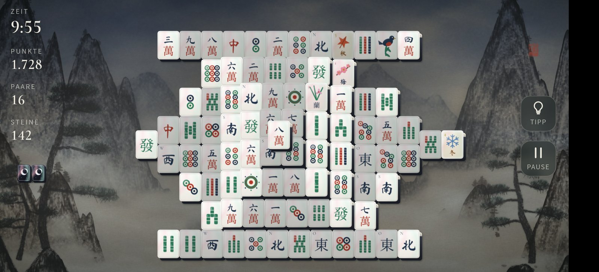

# Misty Mahjong

Ein ruhiges Mahjong-Solitär für Android-Smartphones und -Tablets, mit fünf eigenen Steinsätzen aus edlen Materialien, eigener Musik und auswählbaren Hintergründen im Stil asiatischer Tuschmalerei.

Status: prototype. Nur für den privaten Gebrauch; die APK wird nicht weitergegeben.



## Was die App macht

Misty Mahjong ist ein klassisches Mahjong-Solitär im Schildkröten-Layout mit 144 Steinen, das komplett offline in einem Vollbild-WebView läuft:

- Zwei freie, gleiche Steine antippen, um sie zu entfernen; Blumen und Jahreszeiten passen innerhalb ihrer Gruppe zueinander. Jede Verteilung ist lösbar; gehen die Paare aus, werden die verbliebenen Steine neu gemischt.
- Zehn Minuten ab dem ersten Paar, Punkte je nach Steinfarbe und verbliebenen Steinen, Folgen in derselben Farbe vervielfachen, Zeitbonus beim Abräumen, gespeicherte Bestleistung. Dazu Tipp, Pause und eine kurze Anleitung.
- Fünf Steinsätze, in den Einstellungen auswählbar und gemerkt, auch mitten im Spiel: Perlmutt (Perlmuttplatte auf dunklem Lack, Rückseite mit eingelegtem Mond), Jade (heller, geäderter Stein mit gravierten, pigmentgefüllten Zeichen, Rückseite mit geschnitztem Ringgeflecht), Seeglas (mattes, lichtdurchlässiges Glas, in dem die Zeichen eingeschlossen liegen, Rückseite mit sandgestrahlten Wellen), Porzellan (weiße Glasur mit Kobaltringen und Emailfarben, Rückseite mit blauem Medaillon) und Schwarzlack (Urushi mit Goldrahmen und Goldflitter auf roten Lackseiten, Rückseite mit Mond über Wellen). Jeder Satz zeigt die überlieferten 42 Bilder mit ihrer roten, grünen und blauen Farbgebung; nur das Material wechselt.
- Gefundene Paare heben ab, drehen sich in der Luft auf die Rückseite und sammeln sich als wachsender Stapel neben dem Feld; das Spiel bleibt dabei bedienbar. Ist das Feld leer, verneigt sich der ganze Stapel.
- Eigenes Logo, eigene Musik und Klänge; alles in dieser App ist eigene Arbeit oder unter einer freien Lizenz (`THIRD-PARTY.md`). Die Steine werden beim Start aus Verläufen, Rauschen und Pfaden gezeichnet, nicht aus Bilddateien geladen.
- Zwei nahtlos laufende Musikstücke, in den Einstellungen auswählbar und gemerkt: „Mondlicht auf dem Teich“ (Koto, Harfe, Erhu und Streicher; Standard) und „Koto und Erhu“. Beim Wechsel blendet die Musik über.
- Mehrere in Tusche und Wasserfarben gemalte Hintergründe, in den Einstellungen auswählbar und gemerkt; außerdem Lautstärke für Musik und Effekte, Vibration und das Hervorheben freier Steine.
- Kein Internet nötig, keine Werbung, kein Tracking: Die App fordert keine Internet-Berechtigung an.
- Im Hintergrund pausiert das Spiel samt Musik; die Zurück-Geste beendet ein laufendes Spiel nicht.

## Bauen

Benötigt: JDK 17 oder neuer, Node 20 oder neuer (nur für die Tests), `zip` und das Android SDK mit Build-Tools 34.0.0 und Plattform 34. Unter Debian/Ubuntu:

```sh
sudo apt install google-android-build-tools-34.0.0-installer google-android-platform-34-installer
```

Ein SDK an anderer Stelle wird mit `ANDROID_HOME` angegeben.

```sh
npm test
scripts/build-apk
```

Ergebnis: `build/misty-mahjong.apk`. Signiert wird mit dem Android-Debug-Schlüssel `~/.android/debug.keystore` (wird angelegt, falls er fehlt). Updates lassen sich nur mit demselben Schlüssel über eine installierte Version installieren.

Musik, Klänge und Hintergründe liegen fertig im Repository; `tools/make_audio.py` (numpy, scipy, ffmpeg) und `tools/paint_backgrounds.py` (numpy, Pillow) erzeugen sie neu.

## Installieren

Die APK aufs Gerät kopieren und öffnen (einmalig „Installation aus unbekannten Quellen“ erlauben) oder per USB:

```sh
adb install -r build/misty-mahjong.apk
```

## Kompatibilität

Android 7.0 (API 24) oder neuer mit aktuellem Android System WebView, Querformat. Geprüft am 2026-10-19 auf einem OnePlus CPH2653 mit Android 16 (alle fünf Steinsätze, flüssig bei 120 Hz), zusätzlich mit simulierter Tablet-Auflösung 2560×1600 bei 320 dpi und in Chromium mit emulierten Tablet-Größen 2560×1600 und 2048×1536.

## Lizenz

Spiel, Grafiken, Musik und Klänge sind eigene Arbeit des Eigentümers. Die eingebetteten Schriften stehen unter der SIL Open Font License (siehe `THIRD-PARTY.md`).
